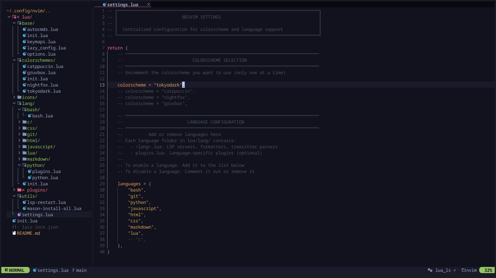

## Showcase




## Setup

#### required packages

```
neovim python3-pip gcc make nodejs wl-clipboard luarocks tree-sitter-cli
```

#### install

```bash
mv ~/.config/nvim ~/.config/nvim.bak
```

```bash
git clone https://github.com/sabamdarif/mynvim.git ~/.config/nvim && nvim
```

## Keymaps

### Buffer cycling

Next/previous buffer is bound to `<M-,>` (Alt+comma) / `<M-.>` (Alt+period), mapped to `BufferLineCycleNext` / `BufferLineCyclePrev`; `<Tab>` / `<S-Tab>` stay with completion.

Terminal caveat — kitty (primary): in kitty's default legacy keyboard encoding the Ctrl modifier is dropped for punctuation such as comma, period, semicolon and apostrophe, so Ctrl+punctuation combinations never reach Neovim. That is why the original Ctrl+comma / Ctrl+period bindings did nothing, and why the offered Ctrl+semicolon / Ctrl+apostrophe alternatives fail the same way. Ctrl+bracket is byte-identical to Escape (binding it would hijack cancel/exit), and Ctrl+close-bracket is already an existing builtin. Alt+punctuation is instead sent as an ESC-prefixed sequence that Neovim decodes reliably as `<M-,>` / `<M-.>`, regardless of keyboard-protocol negotiation.

Delivery test (any terminal): enter insert mode, press `<C-v>` followed by the key (for example `<C-v>` then Alt+comma) and confirm a literal `^[` (ESC) prefix is inserted rather than nothing. If nothing is inserted, the terminal is swallowing the key and needs an explicit mapping before these bindings can be relied on.

Secondary case — Alacritty: this repo ships no custom `key_bindings` for Alacritty and it uses `TERM=xterm-256color`. Alt+comma / Alt+period are delivered as ESC-prefixed sequences there as well, so the same insert-mode `<C-v>` test applies; if a key is swallowed, add a `key_bindings` entry mapping Alt+comma / Alt+period to the raw sequences.

## Acknowledgments:

- [NvChad](https://github.com/NvChad/NvChad)
- [LazyVim](https://github.com/LazyVim/LazyVim)
