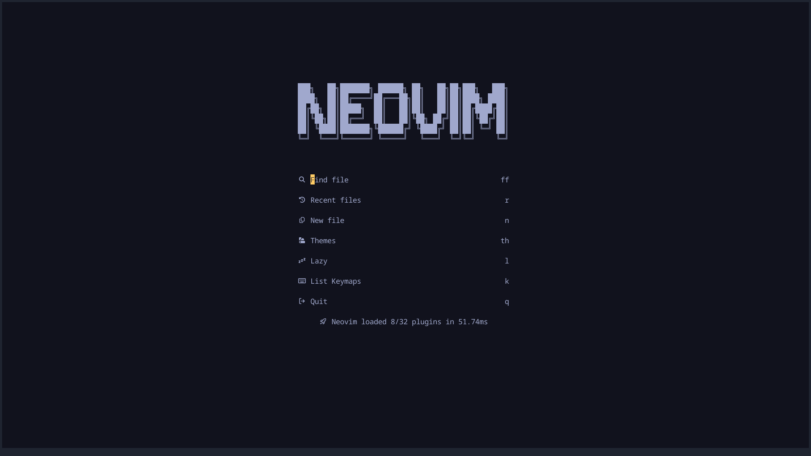

## Showcase




## Setup

#### required packages

```
neovim python3-pip gcc make nodejs wl-clipboard luarocks tree-sitter-cli
```

#### install

```bash
mv ~/.config/nvim ~/.config/nvim.bak
```

```bash
git clone https://github.com/sabamdarif/mynvim.git ~/.config/nvim && nvim
```

## Keymaps

### Buffer cycling

Next/previous buffer is bound to `<C-,>` / `<C-.>` (`BufferLineCycleNext` / `BufferLineCyclePrev`); `<Tab>` / `<S-Tab>` stay with completion.

Terminal caveat: confirm the terminal actually delivers these sequences. In insert mode press `<C-v><C-,>` (and `<C-v><C-.>`) and check a literal control character is inserted rather than nothing. Alacritty in particular ships no custom `key_bindings` in this repo and uses `TERM=xterm-256color`, so if the sequences are swallowed, add a `key_bindings` entry mapping Ctrl+comma / Ctrl+period to the raw sequences before relying on these mappings.

## Acknowledgments:

- [NvChad](https://github.com/NvChad/NvChad)
- [LazyVim](https://github.com/LazyVim/LazyVim)
